<div align="center">


<br />
<br />

# AgendaÍ

**Agendamento online para pequenos negócios de serviço.**
Barbearias, salões, estúdios de tatuagem, manicures e clínicas: o cliente marca pelo app, o dono gerencia tudo num painel.

<br />


[Funcionalidades](#-funcionalidades) •
[Telas](#-telas) •
[Destaques técnicos](#-destaques-técnicos) •
[Arquitetura](#-arquitetura) •
[Como rodar](#-como-rodar) •
[Roadmap](#-roadmap)

</div>

<br />

<p align="center">
  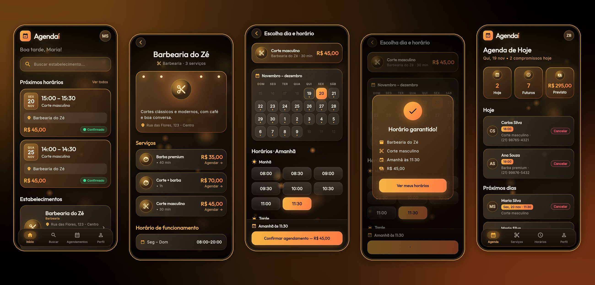
</p>

## ✨ Funcionalidades

<table>
<tr>
<td width="50%" valign="top">

### 👤 Para o cliente
- Cadastro e login com JWT
- Busca de estabelecimentos por nome
- Página do negócio com serviços, preços e horário de funcionamento
- **Calendário** com dias fechados riscados e horários livres por período (manhã, tarde e noite)
- Confirmação com "ingresso" do agendamento
- Próximos horários, histórico e cancelamento

</td>
<td width="50%" valign="top">

### 🏪 Para o dono do negócio
- Cadastro do negócio em poucos segundos (já vem com um horário padrão)
- **Agenda de Hoje**: atendimentos do dia, futuros e faturamento previsto
- CRUD de serviços (duração e preço), com desativar e remover
- Horário de funcionamento por dia da semana
- Cancelamento de atendimentos
- "Ver como cliente"

</td>
</tr>
</table>

## 📱 Telas

### Cliente

<table>
<tr>
<td align="center"><br /><sub><b>Login</b></sub></td>
<td align="center">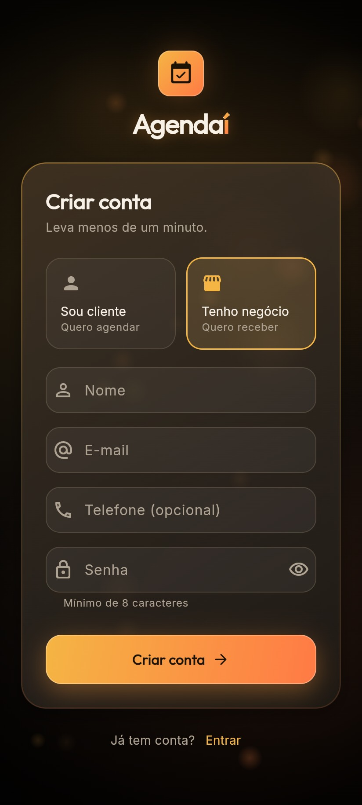<br /><sub><b>Cadastro</b></sub></td>
<td align="center">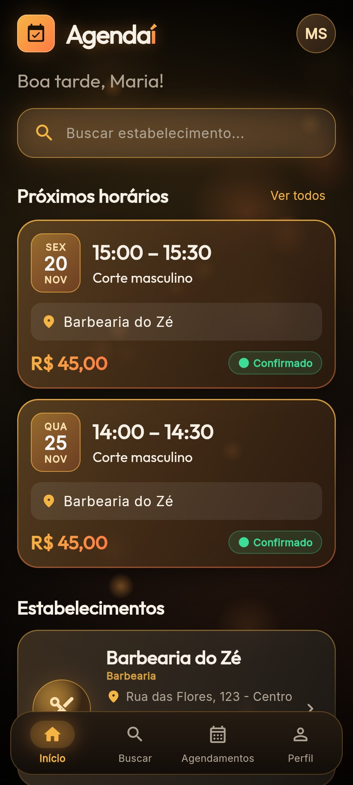<br /><sub><b>Início</b></sub></td>
<td align="center">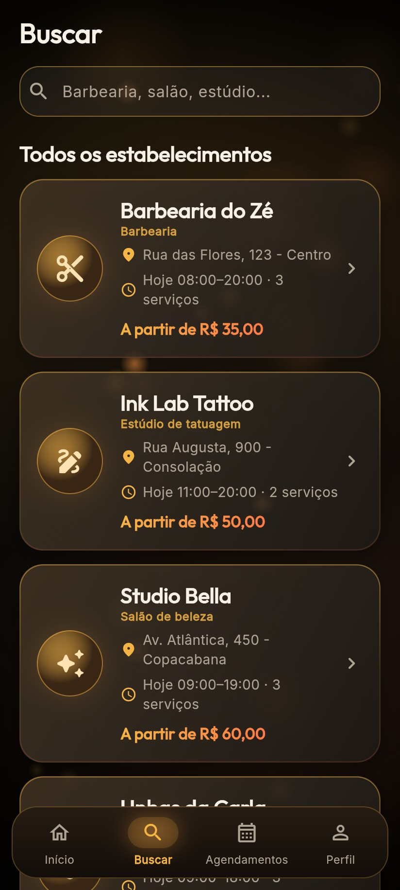<br /><sub><b>Buscar</b></sub></td>
</tr>
<tr>
<td align="center">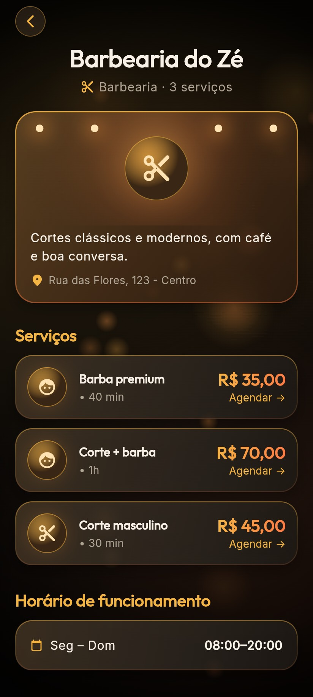<br /><sub><b>Estabelecimento</b></sub></td>
<td align="center">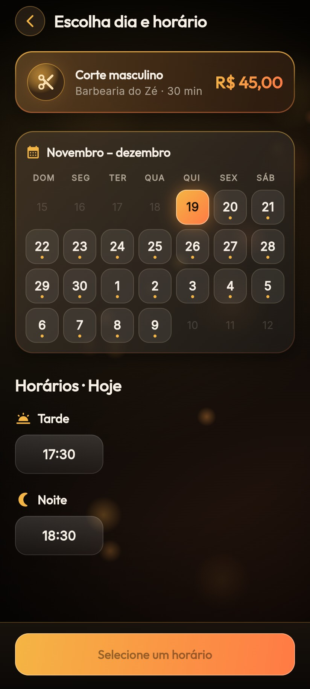<br /><sub><b>Calendário</b></sub></td>
<td align="center">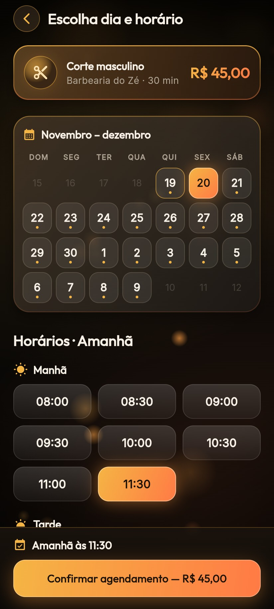<br /><sub><b>Escolha do horário</b></sub></td>
<td align="center">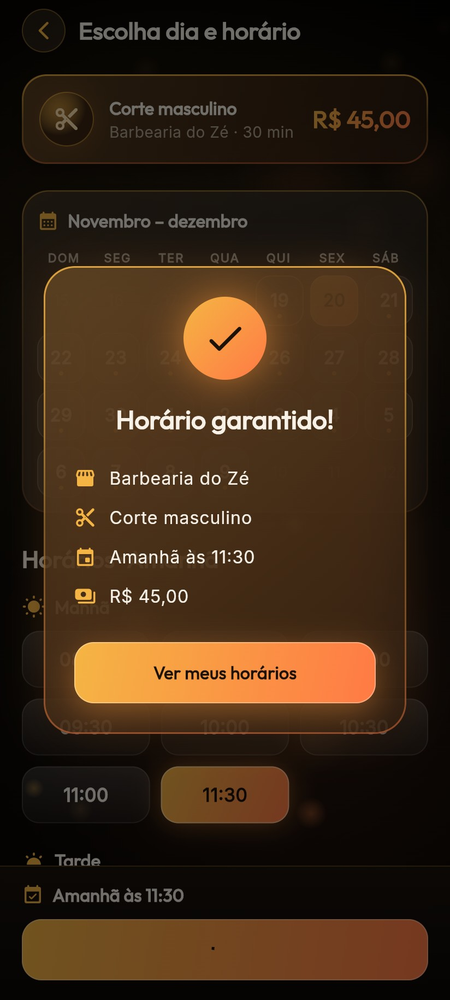<br /><sub><b>Horário garantido</b></sub></td>
</tr>
<tr>
<td align="center"><br /><sub><b>Meus agendamentos</b></sub></td>
<td align="center">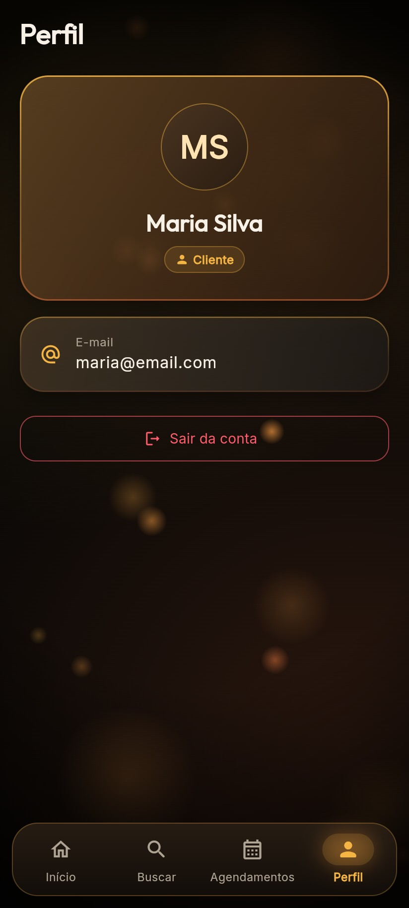<br /><sub><b>Perfil</b></sub></td>
<td></td>
<td></td>
</tr>
</table>

### Dono do negócio

<table>
<tr>
<td align="center"><br /><sub><b>Agenda de Hoje</b></sub></td>
<td align="center">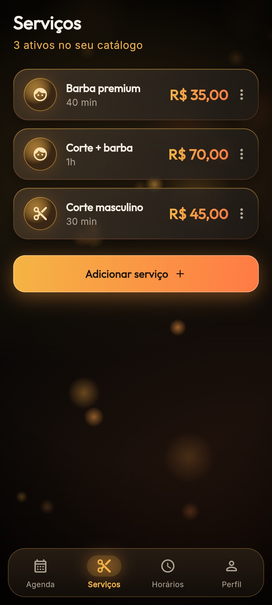<br /><sub><b>Serviços</b></sub></td>
<td align="center">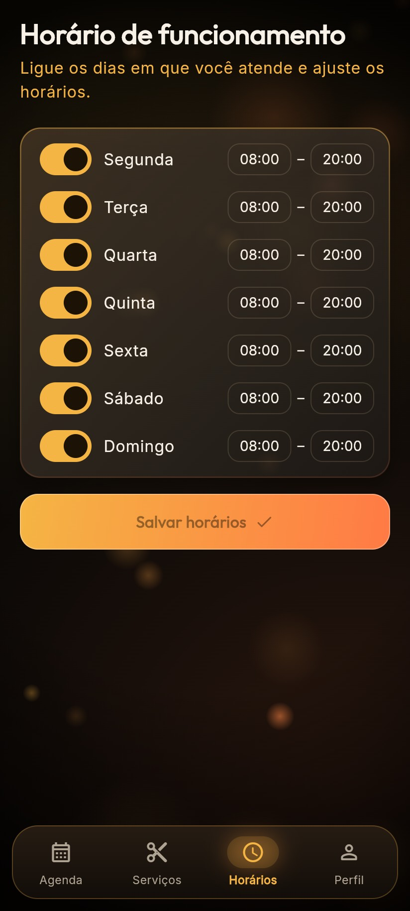<br /><sub><b>Horários</b></sub></td>
<td align="center">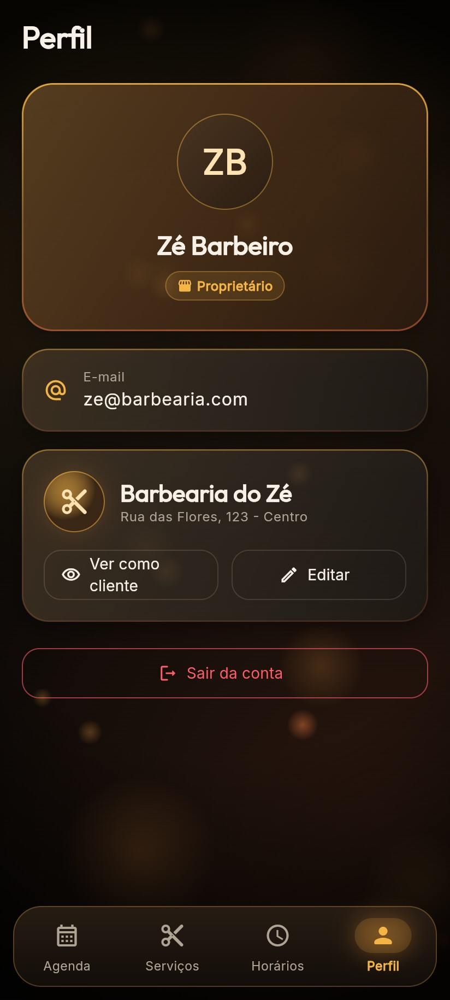<br /><sub><b>Perfil e negócio</b></sub></td>
</tr>
</table>

### Web e desktop

O mesmo código Flutter roda no navegador. Em telas largas, a navegação vira uma barra lateral.

<p align="center">
  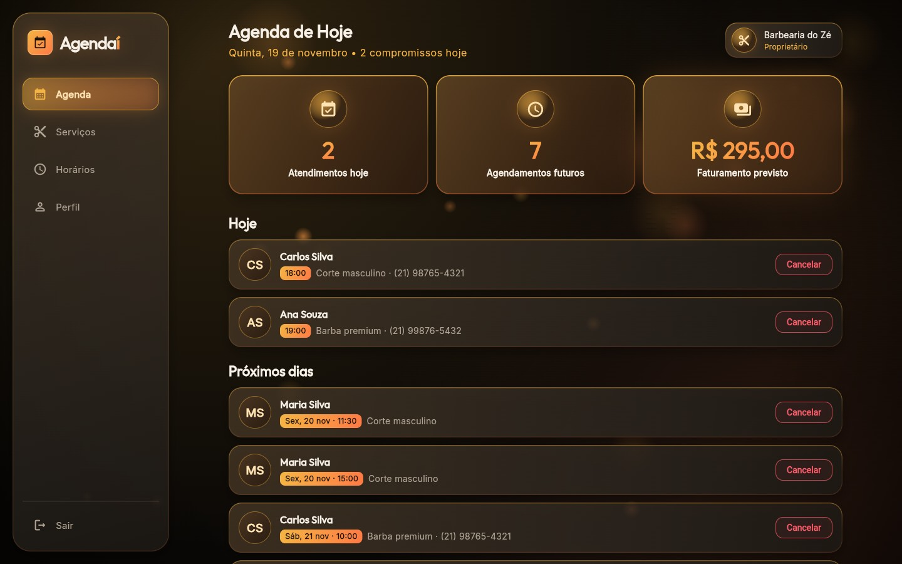
</p>

<table>
<tr>
<td>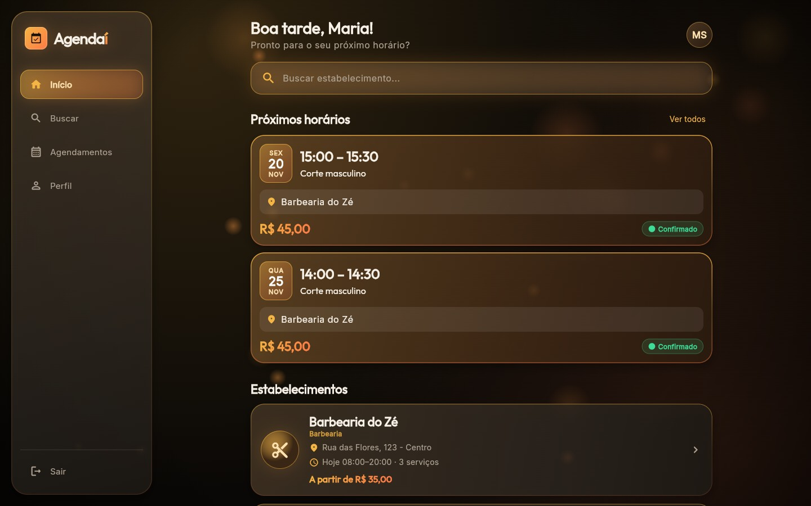</td>
<td></td>
</tr>
</table>

## 🧠 Destaques técnicos

**🔒 Sem reserva dupla, mesmo com acessos simultâneos**
A criação de agendamento roda numa transação que pega um `pg_advisory_xact_lock` por negócio e **revalida o horário antes de gravar**. Num teste com 5 requisições simultâneas para o mesmo horário, 1 foi aceita e 4 receberam `409 Conflict`.

**🧮 Disponibilidade como função pura e testada**
`horários livres = funcionamento − agendamentos − bloqueios − horários que já passaram`.
A regra fica em [`api/src/availability/slots.ts`](api/src/availability/slots.ts), sem acesso a banco, e é coberta por testes unitários (`npm test`).

**🌎 Fuso horário explícito**
As datas trafegam em UTC. O dia e o expediente do negócio são interpretados em `BUSINESS_UTC_OFFSET_MINUTES` (padrão: Brasília, `-180`).

**🛡️ Segurança e permissões**
Senhas com bcrypt e autenticação JWT. Um guard de perfil (`@Auth(Role.OWNER)`) garante que cliente não cria negócio e que um dono não mexe no negócio de outro. Só quem marcou ou o dono do negócio pode cancelar um agendamento.

**⚡ Interface "cinema" leve no Android**
Tema escuro com bokeh animado e cartões de vidro, otimizados para celular:
- Sem `BackdropFilter`; o efeito de vidro vem de degradês.
- Bokeh feito com degradês radiais, a 30 fps.
- A animação pausa quando a tela não está visível ou quando o sistema pede para reduzir animações.
- Fontes embutidas no app.

## 🏗️ Arquitetura

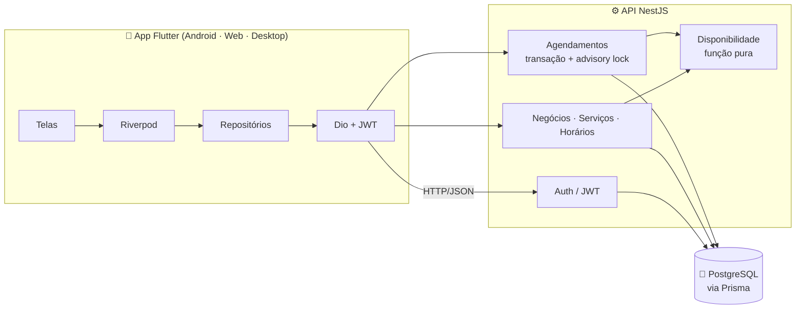

```
APLICATIVO/
├── api/                    # Backend NestJS + Prisma
│   ├── prisma/             # schema, migrations e seed de demonstração
│   └── src/
│       ├── auth/           # cadastro, login, JWT
│       ├── businesses/     # negócios, serviços, horários, disponibilidade
│       ├── appointments/   # criar, listar e cancelar agendamentos
│       ├── availability/   # cálculo de horários livres (+ testes)
│       └── common/         # decorators @Auth e @CurrentUser
├── app/                    # App Flutter
│   └── lib/
│       ├── core/           # tema, rotas, cliente HTTP, componentes visuais
│       └── features/       # auth, booking (cliente), owner (dono), profile
├── docs/                   # capa e prints do README
└── docker-compose.yml      # PostgreSQL local
```

## 🚀 Como rodar

**Pré-requisitos:** Docker, Node.js 20+ e Flutter 3.50+.

```bash
# 1. Banco de dados (PostgreSQL na porta 5433)
docker compose up -d

# 2. API
cd api
cp .env.example .env
npm install
npx prisma migrate dev
npx prisma db seed        # dados de demonstração (opcional)
npm run start:dev         # http://localhost:3000 · Swagger em /docs

# 3. App
cd ../app
flutter pub get
flutter run -d chrome                                    # web
flutter run --dart-define=API_URL=http://10.0.2.2:3000   # emulador Android
```

**Contas de demonstração** (depois do seed), todas com a senha `senhaForte123`:

| Perfil | E-mail |
|---|---|
| Cliente | `maria@email.com` |
| Dono (Barbearia do Zé) | `ze@barbearia.com` |
| Dona (Studio Bella) | `bella@studiobella.com` |

<details>
<summary><b>📲 Instalar no celular Android (mesma rede Wi-Fi)</b></summary>

<br />

```bash
cd app
flutter build apk --release --split-per-abi \
  --dart-define=API_URL=http://IP_DO_SEU_PC:3000
```

Instale `build/app/outputs/flutter-apk/app-arm64-v8a-release.apk` no celular. O PC precisa estar com a API rodando e na mesma rede.

</details>

<details>
<summary><b>🧪 Testes</b></summary>

<br />

```bash
cd api && npm test      # cálculo de disponibilidade
cd app && flutter analyze
```

</details>

## 🗺️ Roadmap

- [x] **Fase 1: Base.** Monorepo, Docker, modelo de dados, auth JWT, Swagger, telas de login e cadastro.
- [x] **Fase 2: Núcleo do negócio.** CRUD do dono, disponibilidade, agendamento sem conflito, fluxo completo do cliente.
- [x] **Visual.** Tema "cinema", navegação adaptativa (celular e desktop), ícone e identidade visual.
- [ ] **Fase 3: Painel do dono.** Agenda por semana, bloqueio de horários (folga, almoço) e dashboard de faturamento.
- [ ] **Fase 4: Entrega.** Testes e2e e de widget, CI com GitHub Actions, deploy da API e da versão web.

## 👨‍💻 Autor

Feito por **Diego Silva**: [github.com/thediegosilva](https://github.com/thediegosilva)

<sub>As fontes Inter e Outfit são distribuídas sob a SIL Open Font License (veja `app/assets/google_fonts/`).</sub>
